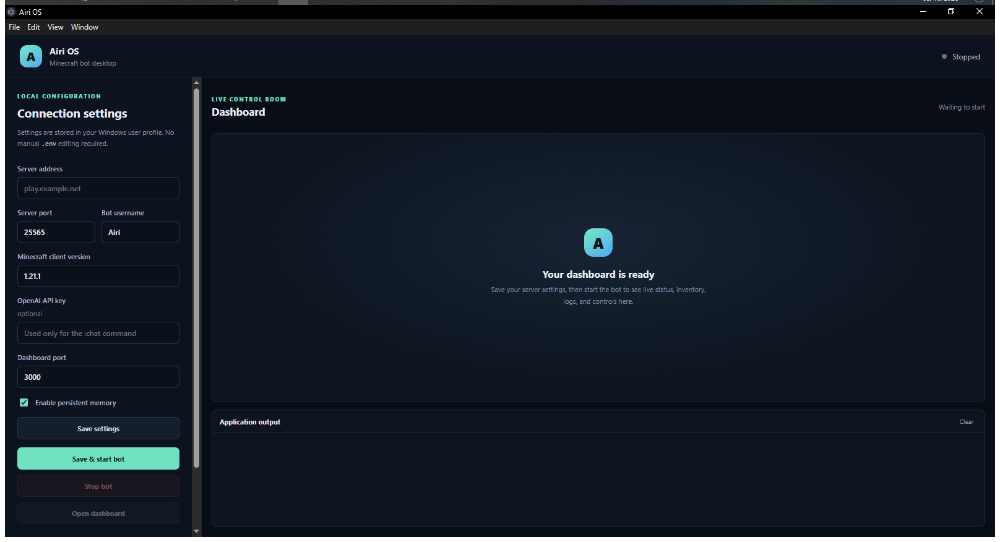

# Airi OS

**A configurable Minecraft bot with a live dashboard and a Windows desktop app.**

<p align="center">
  
</p>

The desktop app brings server configuration, connection status, application output, and the existing web dashboard together in one window. You can also run the bot directly with Node.js.

> **AI-assisted project:** AI tools were used to help create parts of Airi OS. Generated code and Minecraft actions can be imperfect; review settings and actions before use.

**Created by [Hexamania](https://github.com/Hexamania).**

## Features

- **Windows desktop app** with server address, port, username, Minecraft client version, dashboard port, memory toggle, and optional OpenAI key settings.
- **Installer mode selection:** install normally with shortcuts and an uninstall entry, or use portable mode in a folder of your choice.
- **Live dashboard** for connection state, vitals, coordinates, inventory, equipment, logs, and bot controls.
- **Bot automation** for navigation, mining, gathering, crafting, survival, and combat.
- **Persistent memory** for locations, recognized players, the current task, rules, and learned facts.
- **Optional AI chat** through OpenAI.
- **Persistent application output** with separate bot stdout and error streams, startup diagnostics, log history, filtering, and copy controls.

## Windows Desktop App

### Use the Installer

Download or build the installer, run it, and choose one of the two modes:

- **Install normally** creates Windows shortcuts and an uninstall entry. Settings and memory are stored in the current Windows user's application-data folder.
- **Portable mode** keeps the app in the selected folder, creates `portable.txt` beside `Airi OS.exe`, and stores settings and memory in `portable-data` beside the executable. It does not create Windows shortcuts or an uninstall entry.

The optional OpenAI key is encrypted using Windows secure storage. It is tied to the Windows user account, so it is not automatically portable between different accounts or computers.

Build the x64 installer from source:

```bash
npm install
npm run desktop:dist
```

The installer is created in `dist/`. To run the desktop app from source during development:

```bash
npm run desktop
```

### Run an Unpacked Portable Copy

Place an empty `portable.txt` beside `Airi OS.exe` and launch it. The app will create `portable-data` beside the executable for settings and memory.

## Configure and Start

In Airi OS, enter:

| Setting | Purpose |
| --- | --- |
| Server address and port | Minecraft server to connect to |
| Bot username | In-game username used by the bot |
| Minecraft client version | Mineflayer-supported client version; choose one compatible with the server |
| Dashboard port | Local port used by the embedded dashboard |
| Persistent memory | Enables or disables reading and writing the memory file |
| OpenAI API key | Optional; used for the in-game `:chat` command |

Save settings, then select **Save & start bot**. The local dashboard server listens on loopback when launched by the desktop app. Use **Stop bot** to stop the child bot process.

If startup fails, check the **Application output** panel. Recent logs are saved as `airi-os.log` beside the desktop settings, including in the `portable-data` folder for portable mode.

## Run with Node.js

Requirements: Node.js 18 or newer and a Minecraft server reachable by the machine running the bot.

```bash
npm install
```

Create a `.env` file in the project root (see `.env.example` for all options):

```env
MC_HOST=localhost
MC_PORT=25565
MC_USERNAME=Airi
MC_VERSION=1.21.1
WEB_PORT=3000
ENABLE_MEMORY=true
OPENAI_API_KEY=your_openai_api_key
```

Start the bot or run it with Node's watch mode:

```bash
node bot.js
npm run dev
```

Then open `http://localhost:3000` in a browser. Do not commit `.env` or publish API keys.

## Persistent Memory

With `ENABLE_MEMORY=true`, Airi stores structured data in `memory.json`: saved locations, recognized players, the current task, behavioral rules, and learned facts. Set `ENABLE_MEMORY=false` to disable memory file reads and writes.

In the desktop app, memory is stored alongside the desktop settings: in Windows application data for a normal installation, or in `portable-data` for portable mode.

In-game, use `:remember <key>=<fact>` to save a fact and `:forget <key>` to remove one.

## In-Game Commands

Commands use `:` for public actions. Admin actions use `$` after authenticating in a private message with `$loginadmin <password>`.

| Command | Action |
| --- | --- |
| `:ping`, `:status`, `:coords` | Check responsiveness, task status, or location |
| `:chat <message>` | Ask the configured AI assistant |
| `:sbase [x y z]`, `:home` | Save a home location or return to it |
| `:sminebase`, `:minebase` | Save or return to a mining base |
| `:miner <north\|south\|east\|west> [length]` | Dig a tunnel |
| `:lumberjack [radius]` | Gather nearby logs |
| `:rescue`, `:medic <player>` | Provide nearby player support |
| `:sort`, `:deposit`, `:refuel` | Manage nearby storage and resources |
| `:remember <key>=<fact>`, `:forget <key>` | Manage persistent learned facts |
| `$guard`, `$pvp <player>`, `$stoppvp` | Admin defense and combat controls |
| `$mine <block>`, `$servercmd <command>` | Admin mining or server command |

Use `:help` in game for the bot's current command list.

## Dashboard Controls

The web dashboard (served on the configured port) provides:

- **Console** — live logs and a chat/command input
- **Commands** — buttons for roaming, mining, building, navigation, and quick actions
- **Favorites** — save and teleport to named locations
- **Build** — pre-defined structures (shelter, house) or custom JSON schematics
- **Settings** — toggle stealth, auto-defense, and auto-armor
- **Vitals panel** — health, food, ping, dimension
- **Inventory grid** — 36-slot view with counts
- **Equipment panel** — worn armor and held items

## Project Structure

```
mc-ai-bot/
├── .github/                    # GitHub Actions CI/CD workflows
│   ├── workflows/
│   │   └── ci.yml             # Main CI/CD pipeline
│   └── dependency-review-config.yml
├── build/                      # Build assets
│   └── installer.nsh          # NSIS installer custom page
├── desktop/                    # Electron desktop app
│   ├── ipc/                   # IPC channel definitions
│   ├── renderer/              # Vue 3 renderer (Vite)
│   │   ├── src/
│   │   │   ├── components/    # Vue components
│   │   │   ├── composables/   # Vue composables
│   │   │   ├── stores/        # Pinia stores
│   │   │   ├── types/         # TypeScript types
│   │   │   ├── views/         # Page views
│   │   │   ├── App.vue        # Root component
│   │   │   ├── main.ts        # Renderer entry
│   │   │   └── style.css      # Global styles
│   │   ├── index.html         # Renderer HTML
│   │   ├── vite.config.ts     # Vite config
│   │   ├── tsconfig.json      # Renderer TS config
│   │   └── tsconfig.node.json # Vite config TS config
│   ├── services/              # Main process services
│   │   ├── AutoUpdaterService.ts
│   │   ├── BotProcessManager.ts
│   │   ├── LogService.ts
│   │   ├── NotificationService.ts
│   │   ├── PortableService.ts
│   │   ├── SettingsService.ts
│   │   └── SystemTrayService.ts
│   ├── main.ts                # Main process entry
│   ├── preload.ts             # Preload script
│   ├── tsconfig.json          # Desktop TS config
│   └── renderer.ts            # (legacy)
├── src/                        # Main bot source (TypeScript)
│   ├── bot/                   # Bot core
│   │   ├── features/          # Bot features (combat, inventory, movement)
│   │   ├── BotManager.ts      # Bot lifecycle management
│   │   ├── Config.ts          # Bot configuration
│   │   ├── events.ts          # Event handling
│   │   ├── index.ts           # Bot exports
│   │   ├── PluginManager.ts   # Plugin system
│   │   ├── StateMachine.ts    # State management
│   │   └── types.ts           # Bot types
│   ├── commands/              # Command system
│   │   ├── commands/          # Individual command implementations
│   │   ├── arguments.ts       # Argument parsing
│   │   ├── botCommands.ts     # Bot-specific commands
│   │   ├── Command.ts         # Base command class
│   │   ├── CommandRegistry.ts # Command registry
│   │   ├── help.ts            # Help command
│   │   ├── index.ts           # Command exports
│   │   ├── parser.ts          # Command parser
│   │   ├── permissions.ts     # Permission system
│   │   ├── types.ts           # Command types
│   │   └── webHandler.ts      # Web command handler
│   ├── config/                # Configuration
│   │   └── index.ts           # Config loading/validation
│   ├── memory/                # Persistent memory system
│   │   ├── backup.ts          # Memory backup
│   │   ├── cleanup.ts         # Memory cleanup
│   │   ├── index.ts           # Memory exports
│   │   ├── queries.ts         # Memory queries
│   │   ├── schema.ts          # Memory schema
│   │   └── types.ts           # Memory types
│   ├── plugins/               # Plugin system
│   │   └── index.ts           # Plugin exports
│   ├── types/                 # Shared TypeScript types
│   │   └── index.ts
│   ├── utils/                 # Utility functions
│   │   └── index.ts
│   ├── web/                   # Web server & dashboard
│   │   ├── dashboard/         # Dashboard HTML/JS
│   │   ├── middleware/        # Express middleware
│   │   ├── routes/            # API routes
│   │   ├── socket/            # Socket.IO handlers
│   │   └── index.ts           # Web server entry
│   ├── exports.ts             # Main exports
│   ├── index.ts               # Application entry
│   └── main.ts                # Alternative entry
├── backup_*/                  # Backup folders (ignored)
├── assets/                    # Static assets (icons, preview)
├── dist/                      # Build output (ignored)
├── docs/                      # Documentation
├── .env                       # Environment config (ignored)
├── .env.example               # Environment template
├── .gitignore                 # Git ignore rules
├── .prettierignore            # Prettier ignore rules
├── .eslintignore              # ESLint ignore rules
├── .editorconfig              # Editor configuration
├── docker-entrypoint.sh       # Docker entrypoint script
├── Dockerfile                 # Docker multi-stage build
├── docker-compose.yml         # Docker Compose for dev/prod
├── eslint.config.js           # ESLint flat config
├── prettier.config.js         # Prettier configuration
├── package.json               # Package config & scripts
├── tsconfig.json              # Root TypeScript config
├── desktop/tsconfig.json      # Desktop TypeScript config
├── desktop/renderer/tsconfig.json # Renderer TypeScript config
├── LICENSE                    # ISC License
├── memory.json                # Persistent memory (ignored)
├── users.json                 # User data (ignored)
├── bot.js                     # Legacy bot (JavaScript)
├── index.html                 # Legacy dashboard
└── memory.js                  # Legacy memory
```

## Development

### Prerequisites

- Node.js 18+
- npm 9+

### Install Dependencies

```bash
npm install
```

### Available Scripts

| Script | Description |
| --- | --- |
| `npm run build` | Build main TypeScript project |
| `npm run dev` | Run bot in watch mode (tsx) |
| `npm run start` | Run built bot |
| `npm run build:main` | Build desktop main process |
| `npm run build:renderer` | Build desktop renderer (Vite) |
| `npm run build:desktop` | Build both desktop processes |
| `npm run dev:main` | Dev mode for desktop main |
| `npm run dev:renderer` | Dev mode for renderer (Vite) |
| `npm run dev:desktop` | Both dev modes concurrently |
| `npm run desktop` | Run built desktop app |
| `npm run desktop:dev` | Build and run desktop app |
| `npm run desktop:dist` | Build Windows installer (NSIS + Portable) |
| `npm run lint` | Run ESLint |
| `npm run lint:fix` | Run ESLint with auto-fix |
| `npm run format` | Format with Prettier |
| `npm run format:check` | Check formatting with Prettier |
| `npm run typecheck` | TypeScript type checking (all configs) |
| `npm run clean` | Remove dist folder |

### Code Quality

The project uses:
- **ESLint 9** (flat config) for linting TypeScript/Vue
- **Prettier** for code formatting
- **TypeScript** strict mode for type safety
- **Husky** for pre-commit hooks

Run checks manually:
```bash
npm run lint
npm run format:check
npm run typecheck
```

Or fix automatically:
```bash
npm run lint:fix
npm run format
```

### Docker

Build and run with Docker:

```bash
# Production
docker compose up -d airi-bot

# Development (with hot reload)
docker compose --profile dev up airi-dev

# Build only
docker compose --profile build up airi-builder
```

Or directly with Docker:

```bash
docker build -t airi-os .
docker run -d -p 3000:3000 --env-file .env airi-os
```

### GitHub Actions CI/CD

The pipeline runs on every push/PR to main:

1. **Lint & Type Check** - ESLint, Prettier, TypeScript
2. **Build** - Compile all TypeScript projects
3. **Tests** - Run tests (placeholder)
4. **Build Electron (Windows)** - Create NSIS + Portable installers
5. **Create Release** - Upload installers to GitHub Releases
6. **Dependency Review** - Check PR dependencies
7. **CodeQL** - Security analysis

## Configuration

### Environment Variables

See `.env.example` for all available options:

| Variable | Description | Default |
| --- | --- | --- |
| `MC_HOST` | Minecraft server address | `localhost` |
| `MC_PORT` | Minecraft server port | `25565` |
| `MC_USERNAME` | Bot username | `Airi` |
| `MC_PASSWORD` | Bot password (online mode) | - |
| `MC_VERSION` | Minecraft client version | `1.21.1` |
| `WEB_PORT` | Dashboard port | `3000` |
| `WEB_HOST` | Dashboard bind address | `localhost` |
| `OPENAI_API_KEY` | OpenAI API key | - |
| `OPENAI_MODEL` | OpenAI model | `gpt-4` |
| `ENABLE_MEMORY` | Enable persistent memory | `true` |
| `ADMIN_PASSWORD` | Admin command password | `admin` |
| `ADMIN_PREFIX` | Admin command prefix | `$` |
| `PREFIX` | Public command prefix | `:` |

### Desktop App Settings

Settings are stored in:
- **Normal install:** `%APPDATA%/Airi OS/settings.json`
- **Portable mode:** `<install-dir>/portable-data/settings.json`

The OpenAI key is encrypted using Windows DPAPI (user-scoped).

## Building the Installer

```bash
# Install dependencies
npm ci

# Build everything
npm run build
npm run build:desktop

# Create Windows installer
npm run desktop:dist
```

Output: `dist/Airi OS Setup 2.0.0.exe` and `dist/Airi OS-2.0.0-x64.exe` (portable)

Requires Windows for NSIS build. The GitHub Actions workflow handles this automatically on `windows-latest`.

## Contributing

1. Fork the repository
2. Create a feature branch
3. Make changes with proper types and formatting
4. Run `npm run lint:fix && npm run format && npm run typecheck`
5. Submit a PR

## License

ISC License - see [LICENSE](LICENSE) for details.

## Notes

- A version accepted by Mineflayer is not necessarily identical to the server's version; select a compatible client version when connecting through ViaVersion.
- The installer is currently configured for Windows x64 only.
- Bot actions that mine, build, or interact with other players can change a shared world. Test those actions in a safe area or server.
- This project uses Electron 28, Vue 3, Pinia, TypeScript, and Mineflayer 4.